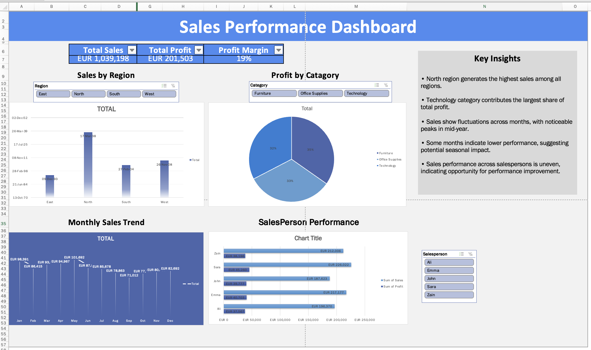

# 📊 Sales Performance Dashboard (Excel)

## 📌 Project Overview

This project presents an interactive **Sales Performance Dashboard** built in Microsoft Excel to analyze and visualize key business metrics. The objective is to provide actionable insights into sales trends, regional performance, product categories, and salesperson efficiency.

---

## 🎯 Business Problem

A retail company wants to:

* Track overall sales and profitability
* Identify high-performing regions and categories
* Monitor monthly sales trends
* Evaluate salesperson performance

This dashboard helps management make **data-driven decisions** by transforming raw data into meaningful insights.

---

## 🛠️ Tools & Skills Used

* Microsoft Excel
* Data Cleaning & Preparation
* Pivot Tables & Pivot Charts
* Data Visualization
* KPI Development
* Dashboard Design
* Business Analysis

---

## 📂 Dataset

**Data source:** simulated sales data (about 2,000 rows) created for practice. All figures and insights below describe this simulated data, not a real company.

* ~2000 rows of sales data
* Includes:

  * Order Date
  * Region
  * Category & Sub-category
  * Salesperson
  * Sales, Quantity, Profit

---

## 🧹 Data Cleaning & Preparation

* Handled missing values and ensured data consistency
* Formatted date and currency fields
* Removed duplicate records
* Converted dataset into structured Excel table
* Created calculated columns:

  * Month
  * Year
  * Profit Margin

---

## 📊 Dashboard Features

### 🔹 Key Performance Indicators (KPIs)

* Total Sales
* Total Profit
* Profit Margin

### 🔹 Visualizations

* Sales by Region (Bar Chart)
* Profit by Category (Pie Chart)
* Monthly Sales Trend (Line Chart)
* Salesperson Performance (Bar Chart)

### 🔹 Interactivity

* Slicers for:

  * Region
  * Category
  * Salesperson

---

## 📈 Key Insights

* North region is the top-performing region in terms of total sales
* Technology category generates the highest share of total profit
* Sales trends show fluctuations with peak performance in mid-year
* Seasonal variations are observed in lower-performing months
* Sales performance varies across salespersons, indicating opportunities for improvement

---

## 🖼️ Dashboard Preview



---

## 📁 Project Structure

```
excel-sales-dashboard/
├── sales_cleaned.xlsx                  cleaned dataset and dashboard workbook
├── screenshots/
│   └── sales-dashboard-overview.png    dashboard preview
├── LICENSE
└── README.md
```

---

## 🚀 Conclusion

This project demonstrates the ability to:

* Clean and transform raw data
* Build interactive dashboards
* Generate business insights
* Present data in a clear and professional manner

---

## 👩‍💻 Author

**Saba Zafar**
Data Analyst & Learning Analytics Researcher

* Portfolio: [sabazafar209-wq.github.io/sabazafar.github.io](https://sabazafar209-wq.github.io/sabazafar.github.io/)
* ORCID: [0009-0002-3922-176X](https://orcid.org/0009-0002-3922-176X)
* Email: sabazafar209@gmail.com

---

## 📄 License

Released under the [MIT License](LICENSE).
